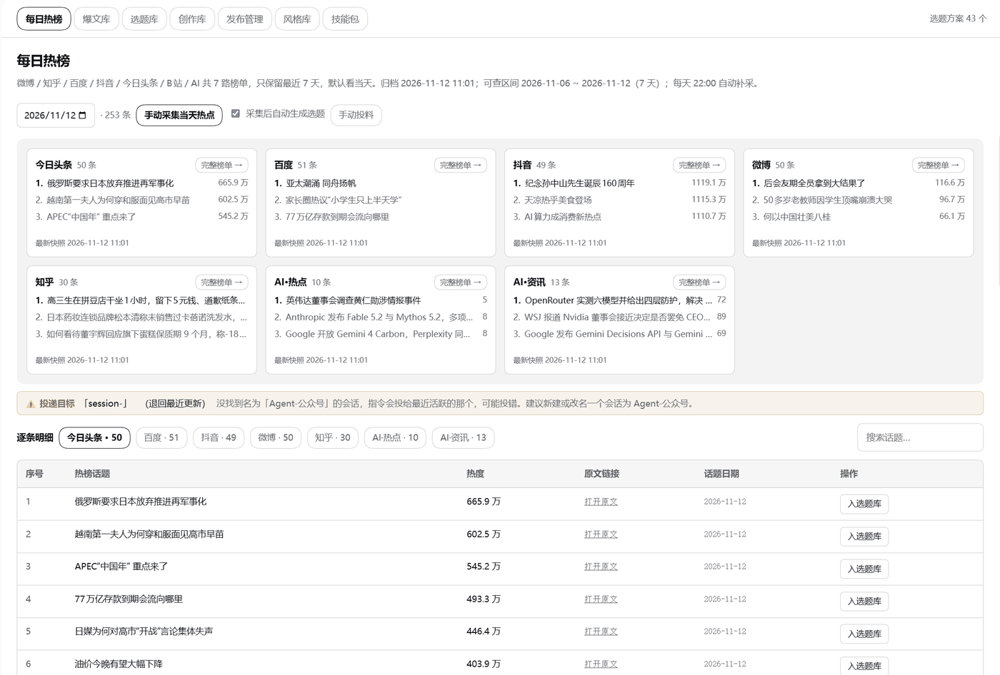
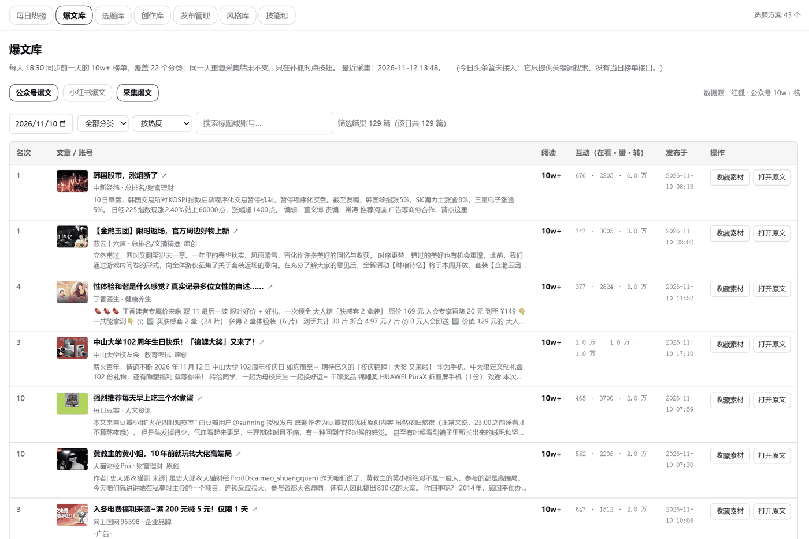
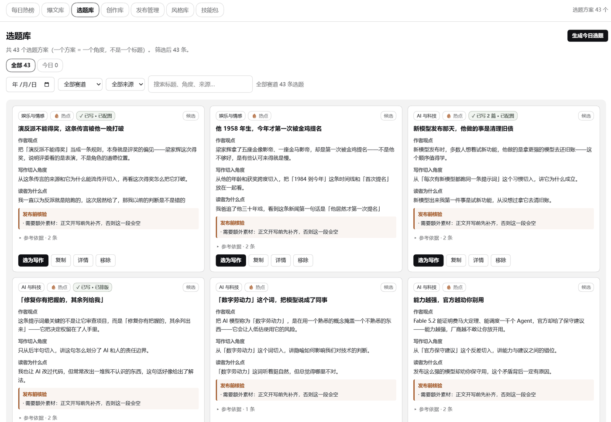

# dsh-workbench · 公众号创作工作台

**当前版本：`0.1.0`**（初始版本，后续持续迭代）

DeepSeek Harness（DSH）桌面端插件。把公众号内容生产的完整链路收进一个面板：
**找选题 → 写稿 → 审稿 → 配图 → 排版 → 发到草稿箱**。

它不是一堆对话式工具，而是一个**面板产品**——左侧栏多出菜单项，进去是标签页，
数据落在工作区的 SQLite 里，Agent 与界面共用同一份。

---

## 一、这是什么

| 项目 | 说明 |
|---|---|
| 版本 | `0.1.0`（初始版本） |
| 形态 | DSH 插件（bundle patch + web client 半 + node 半） |
| 面向 | 公众号运营、自媒体作者、内容团队 |
| 核心 | 三个工作台：**技能库**、**公众号工作台**、**生图工作台** |
| 数据 | 工作区内的 SQLite（`<workspace>/workbench/workbench.db`，9 张业务表） |
| 联网 | 装完即用；抓素材、配图等需联网的环节按需触发 |

---

## 二、功能

### 2.1 三个工作台

**技能库**

集中查看随包分发的 50 个技能，按工作台分组，显示每个技能的用途、脚本与路径。

**公众号工作台**（7 个模块）

| 模块 | 做什么 |
|---|---|
| 每日热榜 | 7 个平台的当日热榜，支持 7 天归档回溯 |
| 爆文库 | 公众号 22 个分类 + 小红书 25 个分类的存量爆款，带封面与互动数 |
| 选题库 | 一行一个选题方案，可按赛道筛选、选为写作 |
| 创作库 | 草稿全生命周期管理，从排队到已群发 |
| 发布管理 | 发布动作记录，草稿箱与群发分开记账 |
| 风格库 | 文字风格（语气变体）的量化定义与自检 |
| 技能包 | 该工作台用到哪些技能、挂在哪个阶段 |

#### 每日热榜

微博 / 知乎 / 百度 / 抖音 / 今日头条 / B站 / AI 共 7 路榜单，保留最近 7 天可回溯。
每路可展开看完整榜单，逐条点【入选题库】进入选题流程。



#### 爆文库

每日同步前一天的 10w+ 榜单，覆盖公众号 22 个分类，带封面、阅读数、在看/赞/转数据，
可直接【收藏素材】或【打开原文】。



#### 选题库

一行一个选题方案（一个方案 = 一个角度，不是一个标题）。每张卡片给出作者观点、
写作切入角度、读者为什么点，以及**发布前核验**提示（缺哪些素材），
确认后点【选为写作】进入创作库。



**生图工作台**（7 个模块）

| 模块 | 做什么 |
|---|---|
| 漫图创作 | 左表单右预览，选风格/图型/色卡后组提示词出图 |
| 风格库 | 手绘风格库，含编号参考图 |
| 图型库 | 排版图型库 |
| 主色调 | 经典单色色卡 |
| 角色资产库 | 角色 / 道具 / 场景三类资产，可复用到后续创作 |
| 我的创作 | 生成结果归档，按张计费 |
| 技能包 | 该工作台用到哪些技能 |

### 2.2 创作流水线

```
每日热榜 / 爆文库
   │  点【入选题库】→ 填预设 → 入队
   ▼
待分析队列 ──▶ Agent 跑选题技能
   │
   ▼
选题库（一行 = 一个方案）── 点【选为写作】
   │
   ▼
创作库：排队 → 草稿 → 打磨 → 审稿 → 排版 → 配图 → 入草稿箱 → 群发
        │       │       │       │       │       │
        ▼       ▼       ▼       ▼       ▼       ▼
     draft.md  review.md  article.md  article.html  imgs/*.png  publishes 记录
```

每个阶段都有对应的检查脚本，产物不合格会被拦下。

### 2.3 素材来源

| 平台 | 来源 |
|---|---|
| 今日头条 / 百度 / 抖音 | 各自官方榜单接口 |
| 微博 / 知乎 | 60s 聚合接口 |
| AI·热点 / AI·资讯 | AIHOT 接口（多源交叉，带摘要） |

也支持**手动投料**：每日热榜 →「手动投料」→ 贴文字 + 传图片（单张 ≤12MB）。

### 2.4 赛道

8 类，用于决定选题方向与写作技能：

社会民生 · 娱乐与情感 · AI 与科技 · 国际与时事 · 财经与商业 · 文化与生活 · 体育与健康 · 教育与职场

另有「自动判断」选项，由 Agent 按标题决定。

---

## 三、架构

### 3.1 三层结构

| 层 | 文件 | 职责 |
|---|---|---|
| client 半 | `lib/client.template.js` → 生成 `lib/client.js` | 界面：标签页、弹窗、抽屉、全文阅读。注册 `main` + `sidebar.panellist` 槽位 |
| node 半 | `lib/index.js` | 带鉴权的 HTTP 路由（20 条，全部挂在 `/api/workbench/` 下）。界面与磁盘之间的桥 |
| 数据层 | `tools/workbench-db.py` / `tools/image-db.py` | SQLite 访问，Agent 直接调，node 半通过 `execFile` 调 |

SQLite 访问绕一层 Python，是因为给 Electron 编译 `better-sqlite3` 存在 ABI 问题，
而 Python 标准库 `sqlite3` 零依赖。

> 改界面请改 `lib/client.template.js`，再跑 `tools/build.py` 生成 `lib/client.js`。
> 直接改 `client.js` 会在下次生成时被覆盖。

### 3.2 数据层

库文件：`<workspace>/workbench/workbench.db`，共 9 张业务表。

| 表 | 作用 |
|---|---|
| `topic_jobs` | 待分析队列 |
| `topics` | 选题库（一行 = 一个选题方案） |
| `drafts` | 创作库（一行 = 一篇稿） |
| `publishes` | 发布动作记录 |
| `writing_styles` | 文字风格库（一行 = 一种语气） |
| `image_jobs` | 生图任务队列 |
| `image_assets` | 生成物（一行 = 一张图） |
| `image_usage` | 生图计费账本 |
| `image_series` | 漫画流（一次创作 = 一组分镜） |

**状态机**

```
topic_jobs : pending → running → done / failed
topics     : candidate → selected → writing → done / dropped
drafts     : queued → draft → polished → reviewed → formatted → illustrated → draftbox → published
image_jobs : queued → running → done / failed
image_series: draft → queued → running → done / failed
```

`drafts.status` 管**内容进度**，`publishes` 管**发布动作**，两个轴分开记。
`draftbox`（已入草稿箱）与 `published`（已群发）必须区分，否则界面会显示错误状态。

**创作配置字段**

`drafts` 表含四个创作配置列：

| 列 | 内容 |
|---|---|
| `theme` | 创作主题（用户输入原文） |
| `materials` | 参考素材（粘贴正文，≤5000 字） |
| `requirement` | 用户要求（观点 / 风格 / 角度） |
| `config_json` | 结构化配置：`{words, wordKey, styleTab, styleKey}` |

### 3.3 目录结构

```
dsh-workbench/
├── package.json          dsh.bundle.patch + dsh.client.platform:web
├── cordis.patch.yml      插件挂载声明
├── install.py            一键安装
├── lib/
│   ├── index.js          node 半：20 条路由 + mdToHtml 转换器
│   ├── client.template.js  client 半源码（改这个）
│   └── client.js         生成物（不要手改）
├── tools/                命令行工具（建库、检查、抓数、生图、构建）
├── skills/               50 个依赖技能（技能库）
├── writing-dna/          写作风格分析方法论
├── skills-manifest.json  技能清单（机器可读）
├── SKILLS-CREDITS.md     技能来源与许可证
└── README.md
```

---

## 四、安装

### 4.1 环境要求

| 项 | 要求 |
|---|---|
| Python | 3.9 或更高（安装器会自检） |
| DSH | 桌面端已安装并至少启动过一次 |
| 磁盘 | 约 120 MB（含技能库） |
| 网络 | 安装阶段不需要；使用抓数、配图功能时需要 |

### 4.2 安装步骤

```bash
python install.py            # 自动完成全部步骤
python install.py --check    # 只检查环境，不做任何改动
python install.py --no-net   # 跳过上游补下载（技能随包分发，通常用不到）
```

安装器会依次完成：

1. 检查 Python 版本与必需目录
2. 初始化数据库（9 张业务表）
3. 生成 `lib/client.js`（界面代码）
4. 安装依赖技能到 `$DSH_HOME/skills/`
5. 检查插件挂载情况，给出下一步指令
6. 生成安装报告

技能随包分发，**安装阶段不需要联网**。若包内缺某个技能（手工删过或使用精简包），
会自动按 `skills-manifest.json` 从上游补下载；断网也不影响安装完成，只是对应功能会提示缺技能。

### 4.3 挂载到 DSH

安装器会打印当前状态。若尚未挂载，需要改 profile 的 `package.json` 并建立链接。

**先做这一步，两种情况都要**：**完全退出 DSH**（关窗口不够，托盘也要退，
确认任务管理器里没有 DSH 进程）。client 半按模块 id 加载，必须重启进程才生效；
而且 DSH 运行时**会占用 profile 目录**，不停掉会导致下一步写文件失败。

profile 位置：`%USERPROFILE%\.dsh\profiles\desktop\`

改 `package.json`，两处：

```json
{
  "dependencies": {
    "dsh-workbench": "link:C:/path/to/dsh-workbench"
  },
  "dsh": {
    "profile": {
      "bundles": ["dsh-workbench"]
    }
  }
}
```

> 路径用正斜杠 `/`，或写成转义后的双反斜杠 `\\`。`bundles` 是往已有数组里**追加**，
> 别把原有项覆盖掉。

然后用下面任一方式建立链接。

#### 方式 A：pnpm install（常规）

在 profile 目录执行：

```bash
pnpm install
```

#### 方式 B：手工建目录联接（免 pnpm，推荐作为备选）

本插件**零运行时依赖**（`package.json` 没有 `dependencies`，四个 peer 全部 optional），
`pnpm install` 在这里只干一件事：把插件目录链到 `node_modules`。这一步手工也能做：

```powershell
cmd /c mklink /J "%USERPROFILE%\.dsh\profiles\desktop\node_modules\dsh-workbench" "C:\path\to\dsh-workbench"
```

`/J` 是目录联接（junction），**不需要管理员权限**。若提示已存在，先删掉旧的再建。

做完启动 DSH，左侧栏会出现「公众号工作台」与「生图工作台」。

#### 如果 pnpm 报 EPERM

```
[EPERM] rename '...\package.json.358186889' -> '...\package.json'
```

这不是权限坏了，是 **`package.json` 被占用**。pnpm 改文件的方式是「写临时文件 → rename 覆盖」，
rename 要求目标文件没有任何进程持有句柄。按顺序排查：

1. **DSH 没退干净**（最常见）—— 关掉托盘图标，任务管理器确认无 DSH 进程
2. **杀毒软件实时防护**在扫刚写的临时文件 —— 临时关掉再试
3. **编辑器或资源管理器**打开着该文件 / 该目录 —— 关掉
4. 还不行就直接用上面的**方式 B**，完全绕开 pnpm

### 4.4 验证

```bash
python install.py --check       # 环境自检，不做任何改动
python tools/build.py           # 刷新数据与界面（含文档与草稿校验）
```

两项都应正常退出（`build.py` 最后打印「完成。重启 DSH 后生效。」）。
若 `build.py` 报错，说明本地数据或技能库有问题，按报错提示处理。

---

## 五、依赖

### 5.1 运行环境

| 依赖 | 说明 |
|---|---|
| Python 标准库 | 全部工具零第三方依赖（`sqlite3`、`urllib`、`zipfile` 等） |
| Node.js | 由 DSH 自带，无需单独安装 |
| DSH peer 依赖 | `@deepseek-ai/cordis`、`dsh-client-ui-slots`、`dsh-client-ui-primitives`、`react`，**全部 optional** |

### 5.2 技能库

插件自带 **50 个第三方技能**，作为工作台的技能库随包分发。

| 分类 | 数量 |
|---|---|
| 依赖技能总数 | 50 |
| 带 LICENSE 文件 | 6 |
| 未附带 LICENSE（按依赖收录） | 44 |
| 本项目自建 | 4 |
| 无公开上游 | 2 |

按上游来源：

| 上游仓库 | 许可证 | 技能数 |
|---|---|---|
| [aiworkskills/wechat-article-skills](https://github.com/aiworkskills/wechat-article-skills) | Apache-2.0 | 9 |
| [redfox-data/redfox-community](https://github.com/redfox-data/redfox-community) | 未声明 | 27 |
| [KKKKhazix/khazix-skills](https://github.com/KKKKhazix/khazix-skills) | MIT | 3 |
| [yang0/handraw-style](https://github.com/yang0/handraw-style) | MIT + 署名 | 1 |
| [op7418/Humanizer-zh](https://github.com/op7418/Humanizer-zh) | MIT | 1 |
| [larashero3-dotcom/writing-dna-skill](https://github.com/larashero3-dotcom/writing-dna-skill) | NOASSERTION | 2 |
| [BigPengSays/bigpeng-hot-gzh](https://github.com/BigPengSays/bigpeng-hot-gzh) | MIT | 1 |
| 本项目自建 | 本项目 MIT | 4 |
| 无公开上游 | — | 2 |

完整来源清单、许可证类型与署名要求见 [SKILLS-CREDITS.md](./SKILLS-CREDITS.md)；
逐项机器可读清单（含上游地址与许可证）见 [skills-manifest.json](./skills-manifest.json)。

> 想了解表结构、API 路由、文件结构与扩展方式，请看 [DEVELOPMENT.md](./DEVELOPMENT.md)。

补装或更新技能可从上游重新获取：

```bash
python tools/fetch-skills.py --list      # 列出可下载技能
python tools/fetch-skills.py             # 下载缺失的
```

### 5.3 外部接口

| 接口 | 用途 | 授权 |
|---|---|---|
| 各平台榜单 | 每日热榜 | 公开接口 |
| AIHOT | AI·热点 / AI·资讯 | 见下方说明 |
| 生图 / 文本中转 API | 配图、漫图、主题润色、智能分镜 | 需自备密钥，见 §5.4 |

> **AIHOT 授权提醒**：AIHOT 匿名免费仅限个人非商业、公益非商业、组织内部使用。
> **面向外部的商业用途（含对外发布的公众号内容）须先取得书面授权**，
> 见 <https://aihot.news/terms>。使用前请自行判断适用性。

### 5.4 生图与文本模型的中转 API

生图工作台出图、以及出图前的**主题润色**和**智能分镜**，都走**第三方中转（聚合）API**，
不自带模型、不内置密钥。默认接的是 **GRS AI** 聚合站，你可以沿用，也可以换成别家。

> **注意**：这里的文本模型是**出图那家聚合站自带的**，与 DSH 主对话用的模型是两回事。
> DSH 里配的模型（DeepSeek / Claude 等）不会用在这里；生图工作台要单独配一份 key。

**默认接法**

| 项目 | 值 |
|---|---|
| 中转站 | `https://grsai.dakka.com.cn`（GRS AI 聚合商） |
| 生图接口 | `POST /v1/api/generate` 提交任务，`GET /v1/api/result?id=<任务号>` 取结果（异步） |
| 默认生图模型 | `gpt-image-2.5`，尺寸 `1024x1024`，质量 `auto` |
| 默认文本模型 | `gemini-2.5-flash`（只用于主题润色、智能分镜两处） |
| 密钥位置 | 工作区根目录 `aws.env` 里的 `IMAGE_MODEL_API_KEY` |

**文本模型只用在两个地方**（都是出图前的小步骤，不是写稿）：

1. **主题润色** —— 把「受众: … 用途: …」这类需求说明改写成具体画面描述，只给建议、不自动替换
2. **智能分镜** —— 把一段文案拆成分镜 JSON（漫画流用）

选风格、图型、色卡是**本地查表**（读技能自带的能力表），不调模型，也不花钱。

文本模型默认复用同一个密钥；想分开计费，在 `aws.env` 里另配 `WRITING_MODEL_API_KEY` 即可。

**两种用法**

**① 沿用现在的中转站** —— 只需配置密钥

到 GRS AI 注册、拿到 API Key，然后直接跟 DSH 说：

> 「把 `IMAGE_MODEL_API_KEY` 配到工作区的 `aws.env` 里，值是 xxx」

DSH 会写好 `aws.env`，生图工作台立即可用。想换模型或尺寸，也是说一句就行
（例如「生图默认用 `gpt-image-2`、尺寸改成 `1536x1024`」），会落到工作区的
`.aws-article/config.yaml`。

**② 换成别家平台** —— 让 DSH 改调用程序

不同平台的接口路径、参数格式、轮询方式都不一样，代码里是按 GRS AI 的异步接口写的
（提交拿任务号 → 轮询取结果）。换平台需要改 `tools/image-gen.py`，直接跟 DSH 说：

> 「生图 API 换成 XX 平台，文档是 <链接>，API Key 是 xxx，帮我改一下调用程序」

把目标平台的接口文档或说明交给 DSH，它会改提交/轮询逻辑并实测。**建议先拿一张图跑通再批量出图。**

> **密钥安全**：`aws.env` 已在 `.gitignore` 里，不会进版本库。请不要把真实密钥写进
> README、Issue 或任何会提交的文件。中转站的计费与可用性由该平台决定，本项目不做担保。

---

## 六、常见问题

**左侧栏没有出现菜单项？**
client 半按模块 id 加载，改完配置必须**完全退出 DSH 再启动**，只刷新窗口无效。

**技能显示缺失？**
技能装在 `$DSH_HOME/skills/`。可跑 `python tools/fetch-skills.py` 从上游补下载，
或重新跑 `python install.py`。

**数据库在哪？**
`<workspace>/workbench/workbench.db`。删掉后重跑 `install.py` 会重建。

**能加自己的技能吗？**
可以。放进 `$DSH_HOME/skills/`，跑 `python tools/gen-catalog.py` 刷新目录即可。
新增工作台见 `lib/client.template.js` 顶部的 `APPS` 数组与 `tools/gen-catalog.py` 的 `PACKS`。

---

## 七、免责声明与版权

### 7.1 第三方技能

1. 技能代码**版权归各自作者**所有，本项目不主张任何权利。
2. 各技能的 LICENSE 文件随技能目录一并保留，未做改动。
3. 本项目免费开源，**不销售**技能，也不对技能做商业再授权。
4. 本项目仅作**集成引用**，未修改技能内部实现，未做二次开发。
5. `redfox-data/redfox-community` **未声明许可证**（仓库无 LICENSE 文件），
   其 27 个技能按依赖引用收录。若该仓库作者有异议，请联系我们，会配合调整或移除。

### 7.2 本项目自身

本项目代码采用 MIT 许可证，见 [LICENSE](./LICENSE)。
该许可证**只覆盖插件代码**，不覆盖 `skills/` 下任何第三方技能。

### 7.3 使用风险

- 素材抓取依赖第三方公开接口，接口变更或限流会影响功能可用性。
- AI 生成的文稿、配图需**人工复核**后发布，作者对发布内容负责。
- 发布前请自行确认内容符合平台规范与相关法律法规。

### 7.4 联系方式

技能版权、许可证或内容方面的疑问，请通过 GitHub Issues 联系。

---

## 八、作者与交流

用着有问题、想提需求、或者想聊聊怎么用这个工作台做号，都可以加我微信。

**微信：吾墨**（广东广州）


扫码添加，请备注「**工作台**」，方便我优先通过。

> 交流群还在筹备中，建好后会在这里补上群二维码。
> 也欢迎直接提 [Issue](https://github.com/wm-1688/dsh-workbench/issues)，公开问题在那里讨论更便于后来的人检索。
